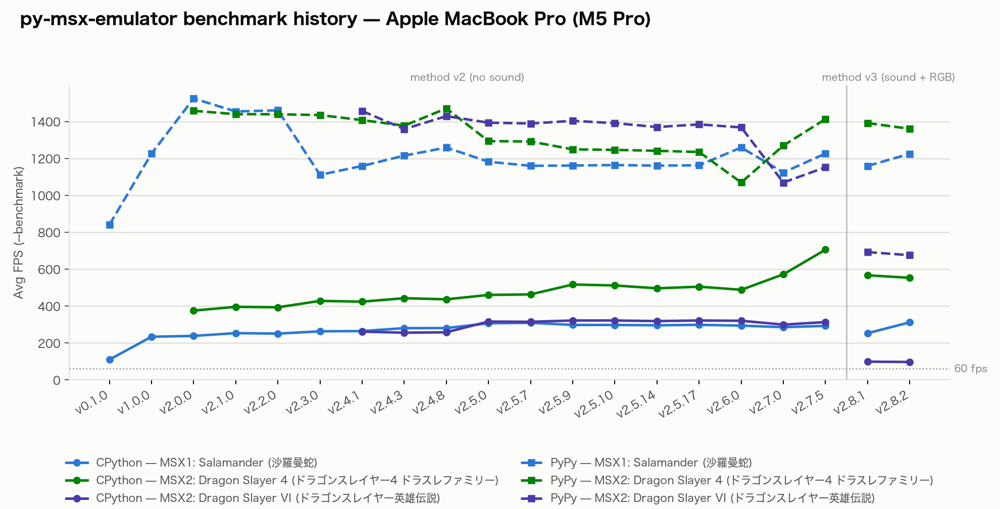
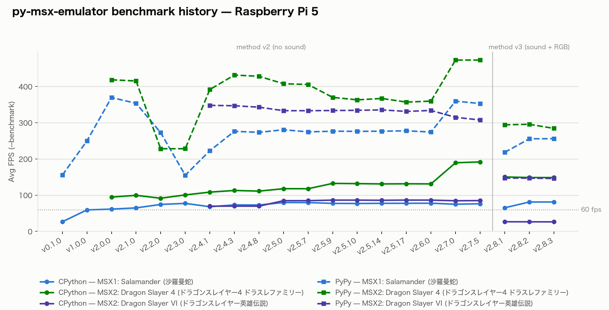

# py-msx-emulator

A functionally accurate MSX1/MSX2 emulator, written in pure Python 3.10+ and
driven by machine-readable component specifications.


[日本語版 README はこちら](README_ja.md)

---

Every hardware component is pure Python. A machine-readable specification
defines each component before its implementation, and these specs drive the
test suite. See [Spec-driven architecture](#spec-driven-architecture) for
details. The component wiring is explicit: `build_machine()` connects the
components by hand, with no reflection or dependency injection. The only
platform-specific dependency is pysdl2, for the display and audio frontend.
[`docs/technical-implementation.md`](docs/technical-implementation.md)
describes the internals.

The emulator needs BIOS ROMs, which the repository does not include. The free
[C-BIOS](https://cbios.sourceforge.net/) works for the generic machines.
[QUICK_START.md](QUICK_START.md) explains the setup.

### Verified hardware and software

The author verified this emulator only against the hardware and software below,
which the author owns. The author tested it only with ROM and disk dumps from
these physical items. There is no guarantee that other MSX1 or MSX2 titles
work. Bug reports for other titles are welcome, but support is best-effort.

**Hardware:**

- [Sony HB-10](https://www.msx.org/wiki/Sony_HB-10)
- [Sony HB-F1XD](https://www.msx.org/wiki/Sony_HB-F1XD)
- [MSX Standard Japanese Cartridge HBI-J1](https://www.msx.org/wiki/Sony_HBI-J1)
- [FM-PAC (FM Pana Amusement Cartridge)](https://generation-msx.nl/software/matsushita-electric-industrial/fm-pana-amusement-cartridge/1072)

**Software:**

- **MSX1:**
  - [Salamander (沙羅曼蛇) by KONAMI](https://generation-msx.nl/software/konami/salamander/941)
  - [Nemesis 2 (グラディウス2) by KONAMI](https://generation-msx.nl/software/konami/nemesis-2/932)
  - [Penguin Adventure (夢大陸アドベンチャー) by KONAMI](https://generation-msx.nl/software/konami/penguin-adventure/873)
  - [Game Master 2 (コナミの新10倍カートリッジ) by KONAMI](https://generation-msx.nl/software/konami/game-master-2/937)
- **MSX2:**
  - [Dragon Slayer IV - Drasle Family (ドラゴンスレイヤーIVドラスレファミリー) by Falcom](https://generation-msx.nl/software/falcom/dragon-slayer-iv-drasle-family/979)
  - [Romancia - Dragon Slayer Jr. (ロマンシア) by Falcom](https://generation-msx.nl/software/falcom/romancia-dragon-slayer-jr/881)
- **MSX2 (floppy disk):**
  - [Dragon Slayer VI - The Legend of Heroes (ドラゴンスレイヤー英雄伝説) by Falcom](https://generation-msx.nl/software/falcom/dragon-slayer-vi-the-legend-of-heroes/1387)
  - [Letter Writer: Print Like Handwriting (はがき書右衛門) by Sony](https://generation-msx.nl/software/sony-corporation/letter-writer-print-like-handwriting/1181)

---

## Contents

- [Emulated hardware](#emulated-hardware)
- [Spec-driven architecture](#spec-driven-architecture)
- [Performance](#performance)
- [Installation](#installation)
- [Usage](#usage)
- [Tools](#tools)
- [Remote control (Socket RPC & MCP)](#remote-control-socket-rpc--mcp)
- [Machine configuration](#machine-configuration)
- [Running tests](#running-tests)
- [Project layout](#project-layout)
- [Contributing](#contributing)
- [Acknowledgements](#acknowledgements)
- [License](#license)
- [History](#history)

---

## Emulated hardware

Each component below is pure Python. "Implementation" gives the source file(s).
"Known limitations" lists the behavior that the emulator does not reproduce
(yet).

### CPU: Zilog Z80

The CPU has the full register file (AF, BC, DE, HL, IX, IY, SP, PC, I, R, and
the shadow registers). It implements all 252 documented opcodes, the
CB/DD/ED/FD prefix tables, and the undocumented IXH/IXL/IYH/IYL
register-access opcodes. It supports maskable interrupts (INT mode 1 and mode
2) and the non-maskable interrupt (NMI). Stepping is T-state accurate, with a
configurable MSX **M1 wait state**. This wait state adds 1 T-state per opcode
fetch, as on a real MSX and in openMSX. The default of 0 keeps the core a pure
Zilog Z80.

- Implementation: `msx/cpu/z80.py`, `msx/cpu/opcodes_main.py`, `msx/cpu/registers.py`
- Known limitations:
  - OTIR/INIR and similar block I/O instructions are not cycle-exact across
    page boundaries.
  - The undocumented flag bits Y (bit 5) and X (bit 3) follow the documented
    per-instruction rules, with three exceptions. The emulator does not model
    the internal MEMPTR register, so `BIT n,(HL)` leaves Y and X clear. It also
    does not model the PC-derived Y/X of a repeating block instruction or the
    dependence of `SCF`/`CCF` on the previous instruction.

### VDP (Video Display Processor): TMS9918A (MSX1)

The VDP has 16 KB of VRAM and 8 control registers. It implements Screen modes
0-3 (Text 40-col, Graphic 1, Graphic 2, Multicolor). It also implements sprite
rendering with size and magnification, the 5th-sprite and coincidence flags,
and the VBlank interrupt.

- Implementation: `msx/vdp/vdp.py`, `msx/vdp/renderer.py`
- Known limitations:
  - The emulator does not emulate mid-frame register-change timing. If a game
    changes the screen mode, colors, or sprite settings mid-frame, the new
    state applies to the whole frame. On real hardware, it applies only from
    the changed scanline onward. The emulator also does not emulate
    undocumented sprite-overflow behavior.
  - During frame skip, the emulator does not update the 5th-sprite and
    coincidence status on a skipped frame. A ROM that polls for collisions in
    turbo mode thus sees stale status from the last rendered frame.

### VDP: Yamaha V9938 (MSX2)

The VDP has 128 KB of VRAM, 28 control registers, and a programmable 16-color
palette (9-bit GRB333). It implements Screen modes 0-8 (SCREEN 0 through
SCREEN 8) and the hardware command engine (HMMV, HMMM, HMMC, LMMV, LMMM, LMCM,
LMMC, YMMM, LINE, PSET, POINT, SRCH). It also implements the horizontal line
interrupt (R#19/R#23, IE1). A banded renderer handles mid-frame register and
palette changes.

- Implementation: `msx/vdp/v9938.py`, `msx/vdp/v9938_renderer.py`
- Known limitations:
  - Command timing is approximate, not cycle-accurate. The emulator does not
    faithfully reproduce beam-raced blits or double-buffered VRAM updates
    within a single frame. Each block command has one cost per byte or dot,
    measured on a real HB-F1XD with the display and sprites on. The speed-up
    with less display or sprite VRAM traffic is not modelled.
  - The emulator does not model the GRAPHIC 6/7 planar VRAM interleave. The
    real chip splits these modes across two VRAM ICs by even/odd byte. The
    emulator uses a linear addressing model instead. The result differs in
    only one case: a program writes VRAM in a planar mode, switches to a
    non-planar mode without a clear, and reads the data back.
  - The R#13 blink timer advances once per frame. This timer controls the
    TEXT2 character blink with R#12 colors and the GRAPHIC4-7 automatic page
    alternation. Thus a mid-frame R#13 write takes effect for the whole frame.
    The emulator does not implement the undocumented R#1 bit 2 per-line blink
    timing. The EO bit of R#9 drives the GRAPHIC4-7 automatic even/odd page
    alternation, as on a real V9938. The half-scanline CRT field-fusion shift
    that gives true interlaced output (double vertical resolution) is a
    deliberate non-goal, to keep the renderer simple and fast.
  - The frame-skip limitation of the TMS9918A (above) applies here too.

### PSG (Programmable Sound Generator): AY-3-8910

The PSG has 16 registers, 3 tone channels, a noise channel, and an envelope
generator with 8 waveform shapes. Its amplitude table comes from measured
silicon. It uses the oscilloscope-measured AY-3-8910 DAC curve from ayumi, not
an idealized geometric curve. The output is 44100 Hz PCM: 735 samples per
frame on NTSC machines (60 fps) and 882 on PAL machines (50 fps).

**Sub-frame software-PCM** reproduction records the cycle timestamp of each
volume-register write. It then replays each write at its sample position in
the frame. The tone generator integrates over each output sample. Thus an
ultrasonic period-0 PCM carrier gives its band-limited duty average and does
not alias to a full/zero chop.

- Implementation: `msx/psg.py`

### Key click: PPI Port C bit 7

PPI Port C bit 7 (I/O port 0xAA) drives a 1-bit DAC. Each change of the bit
sets the output to 0 or to a fixed level. The emulator records the cycle of
each change and places the change at its sample position in the frame. The
Majutsushi cartridge DAC works in the same way. Thus the BIOS key click is audible, and
software that toggles the bit plays 1-bit PCM. The level relative to the PSG
follows openMSX's machine configurations.

- Implementation: `msx/ppi.py`, `msx/dac.py` (the write-driven DAC channel
  that the key click and the Majutsushi DAC share)
- Known limitations:
  - The mix has no DC-blocking stage. On a real MSX, the click decays to
    silence after each edge. Here, a bit held at 1 stays as a constant offset
    until the next change.

### SCC: Konami SCC (Sound Creative Chip)

A 5-channel wavetable synthesizer. The emulator mixes its output into the audio
output with the PSG. The SCC has two modes:

- **Compatible mode** (default): 4 waveform banks of 32 samples each (channel 5
  uses the channel 4 waveform), with 12-bit frequency and 4-bit volume per
  channel. The KonamiSCC mapper activates this mode when a program writes 0x3F
  to 0x9000. The registers then appear at 0x9800.
- **Plus mode**: 5 *independent* waveform banks. The frequency, volume, and
  enable registers move to a different register offset. The SCC-I cartridge
  (see below) uses this mode and selects it through `SCC.set_mode()`.

- Implementation: `msx/scc.py`
- Known limitations:
  - The emulator does not implement the deform/test register
    (frequency-multiply calibration bits, counter reset, and hardware waveform
    auto-rotation).

### SCC-I cartridge ("SCC+")

A bare sound cartridge with no game ROM. Enable it with
`--extension1`/`--extension2 scc_plus`. See
[`docs/README_extension.md`](docs/README_extension.md#scc-i-cartridge-scc) for
activation and slot mechanics. The cartridge targets FDD (floppy-disk) MSX2
titles that use it only for its audio.

The cartridge has 64 KB of physical bank-switched RAM, addressed as if it were
128 KB. The RAM is blank: the emulator never loads a ROM or data file into it.
The bank register ignores bit 3, so block N mirrors block N+8. This reproduces
a documented real-hardware modification (["connect the two 64 KB
banks"](http://bifi.msxnet.org/msxnet/tech/soundcartridge.html)). With it, one
physical SCC-I cartridge works with both factory RAM-population variants. Each
of the two target titles of this project expects one of these variants.

A mode register selects the Compatible or Plus mode of the SCC chip on the
cartridge. The cartridge also has per-window RAM-write control.

> **Note**: the author does not own a real SCC-I (SCC+) cartridge or
> compatible software. This implementation uses publicly available technical
> documentation, and the author has not verified it against real hardware.

| Item | Detail |
| --- | --- |
| Implementation | `msx/mapper.py:SCCICart` |
| Activation | `--extension1`/`--extension2 scc_plus` (see [`docs/README_extension.md`](docs/README_extension.md#scc-i-cartridge-scc)) |
| Memory map | 4 × 8 KB bank-switched RAM windows at `0x4000-0xBFFF`, mode register at `0xBFFE`/`0xBFFF` |
| SCC register window | `0x9800-0x9FFF` (Compatible mode) or `0xB800-0xBFFF` (Plus mode), as the mode register selects |

### FM-PAC: MSX-MUSIC cartridge (YM2413/OPLL)

An optional overlay cartridge. Enable it with `--extension1`/`--extension2
fmpac`. See [`docs/README_extension.md`](docs/README_extension.md#fm-pac) for
activation and ROM requirements. The cartridge has a 64 KB banked ROM, 8 KB of
battery-backed SRAM with an openMSX-compatible magic-value unlock, and a YM2413
(OPLL) FM sound chip. The chip gives 9-channel 2-operator melody
synthesis (15 built-in instruments plus a user-defined tone), ADSR envelopes,
and rhythm mode (bass drum, snare, tom, top cymbal, hi-hat). The emulator
mixes the chip output into the audio output with PSG/SCC.

| Item | Detail |
| --- | --- |
| Implementation | `msx/fmpac.py` (cartridge device), `msx/opll.py` (YM2413/OPLL chip) |
| Activation | `--extension1`/`--extension2 fmpac` (see [`docs/README_extension.md`](docs/README_extension.md#fm-pac)), ROM at `roms/fmpac/fmpac.rom` |
| Memory map | 64 KB ROM in four 16 KB banks (`0x7FF7` bank register) at `0x4000-0x7FFF`. 8 KB SRAM (openMSX-exact `0x1FFE`-byte usable region, magic-value unlock at `0x5FFE`/`0x5FFF`). Memory-mapped OPLL registers (`0x7FF4`/`0x7FF5`) and enable register (`0x7FF6`) |
| I/O ports | `0x7C`/`0x7D`, gated by bit 0 of the enable register |
| SRAM persistence | `saves/sram/fmpac.sram`. The emulator loads it on start and saves it on exit |
| OPLL synthesis | Faithful port of emu2413 v1.5.9: log-domain synthesis (log-sin + exp tables), hardware envelope-rate tables with key-scaling, AM/PM LFO, the YM2413 instrument ROM, and rhythm mode (register `0x0E`: bass drum, snare, tom, top cymbal, hi-hat) with the real short-noise / LFSR taps |

- Known limitations:
  - Output rate conversion uses an accumulate-and-average decimator (chip
    clk/72 → 44100 Hz), not the windowed-sinc resampler of emu2413. The
    analog-style low-pass removes the residual imaging.
  - The emulator includes only the YM2413 instrument set (no VRC7 or YMF281
    banks).
  - No channel masking or stereo pan.

### Sony HBI-J1: Kanji-ROM + MSX-JE word processor

An optional overlay cartridge. Enable it with `--extension1`/`--extension2
hbi_j1`. See [`docs/README_extension.md`](docs/README_extension.md#sony-hbi-j1)
for activation, ROM requirements, and licensing. The cartridge has two parts:

- A JIS Kanji font ROM I/O device at ports `0xD8-0xDB`, with no slot location
  of its own.
- An *expanded* primary slot with two sub-slot devices: a Halnote-mapped
  MSX-JE word-processor ROM with 16 KB battery-backed SRAM, and a flat Kanji
  driver + BASIC extension ROM. `--extension1`/`--extension2` selects this
  slot.

The cartridge connects to a stock MSX2 host. Its expanded slot thus coexists
with the slot 3 expansion of the host machine.

The author physically owns this cartridge and dumped its ROMs. Their SHA1
values match openMSX's `Sony_HBI-J1.xml`. This implementation thus targets real
hardware, not only documentation.

| Item | Detail |
| --- | --- |
| Implementation | `msx/kanji.py` (Kanji-ROM device), `msx/mapper.py:HalnoteMapper` (MSX-JE cartridge), `msx/machine_loader.py` (expanded overlay wiring) |
| Activation | `--extension1`/`--extension2 hbi_j1` (see [`docs/README_extension.md`](docs/README_extension.md#sony-hbi-j1)), ROMs at `roms/hbi_j1/` |
| Kanji-ROM I/O | Ports `0xD8-0xDB`: bit 1 selects JIS level (1/2), bit 0 selects column/row write vs. data read. A 5-bit read counter auto-increments per read and wraps to byte 0 of the same glyph every 32 reads |
| Sub-slot 0 | `HalnoteMapper`: 1 MB ROM (128 × 8 KB banks), 16 KB SRAM at `0x0000-0x3FFF` (bank-0 register bit 7), JIS2 dictionary sub-mapper over `0x7000-0x7FFF` (bank-1 register bit 7) |
| Sub-slot 1 | Flat 32 KB Kanji driver + BASIC ROM at `0x4000-0xBFFF`. `0x0000-0x3FFF`/`0xC000-0xFFFF` are open bus |
| SRAM persistence | `saves/sram/hbi-j1_msx-je.sram`. The emulator loads it on start and saves it on exit |
| Known limitations | The real-hardware behavior after 32 consecutive Kanji-ROM reads without an address rewrite is unverified. This implementation uses the documented openMSX behavior (wrap to byte 0 of the same glyph) as ground truth |

### Audio output filter

An analog-style output low-pass filter (2-pole Butterworth) models the RC
filter on the real MSX audio output. It removes residual imaging and aliasing
from the mixed PSG/SCC/DAC/OPLL/key-click signal.

- Implementation: `msx/audio_filter.py`

### PPI (Programmable Peripheral Interface): Intel i8255

The PPI has the slot-select register (port 0xA8), the 11-row × 8-bit MSX
keyboard matrix (port 0xA9), and row selection (port 0xAA). A read of the
write-only control port 0xAB depends on the PPI chip of the machine. The
`control_read` setting of each machine selects one of these values:

- `control` (default): the last mode word, as on a CMOS 82C55A.
- `open_bus`: 0xFF, as on the S1985 machines. Checked on a real HB-F1XD.
- `bus_latch`: a byte latched from the last PPI access, as on the S3527 in
  `hb_10` and `hb_10_64k`. Checked on a real HB-10.

- Implementation: `msx/ppi.py`
- Known limitations: the emulator does not implement the cassette interface
  (port 0xAA bits 4-5) or the CAPS LED (bit 6). Bit 7 drives the key click
  (see "Key click: PPI Port C bit 7").

### Memory bus / slot system

MSX1 uses a 4-page × 4-slot dispatch. Slot 0 holds the BIOS ROM, slot 1 a
cartridge, slot 2 an optional second cartridge, and slot 3 32 KB of RAM. On
MSX2, primary slot 3 expands into 4 secondary slots. Sub-slot 3-0 holds the
sub-ROM, and sub-slot 3-2 holds the RAM mapper.

`--extension1`/`--extension2` can also expand primary slot 1 and slot 2, each
independently. These expansions coexist with the slot 3 expansion on the same
machine, and each has its own secondary slot register. See
[the "Slot model" section of `docs/README_extension.md`](docs/README_extension.md#slot-model)
for what each slot can hold and which extensions expand a slot. At startup,
the emulator rejects the same ROM or extension id on both cartridge slots.

| Item | Detail |
| --- | --- |
| Implementation | `msx/memory.py` |
| Address space | Flat 64 KB (0x0000-0xFFFF), four 16 KB pages |
| Slot 0 pages 0-1 | BIOS ROM (read-only, 0x0000-0x7FFF) |
| Slot 0 page 2 | Logo ROM (`cbios_logo_msx1.rom`) at 0x8000-0xBFFF. The machine YAML declares it as a `pages: [2]` entry next to the BIOS. Reads return 0xFF if the file is absent |
| Slot 0 page 3 | 16 KB SRAM at 0xC000-0xFFFF on some machines (e.g. `hb_10`). This is volatile work RAM. Unlike cartridge SRAM, it has no battery backup and the emulator does not save it. The machine YAML declares it as a `ram: {size_kb: 16, pages: [3]}` entry next to the BIOS |
| Slot 1 | Cartridge ROM via mapper. Open bus (0xFF on read, writes ignored) when no slot 1 ROM is present. `--extension1` expands it into sub-slots, see [`docs/README_extension.md`](docs/README_extension.md#slot-model) |
| Slot 2 | Second cartridge ROM via `_mapper2`. Open bus (0xFF on read, writes ignored) when no slot 2 ROM is present. `--extension2` expands it into sub-slots, see [`docs/README_extension.md`](docs/README_extension.md#slot-model) |
| Slot 3 (MSX1) | 32 KB RAM at 0x8000-0xFFFF by default. Each machine sets the size (64 KB across all pages on `hb_10_64k`, unpopulated open bus on `hb_10`) |
| Slot 3 (MSX2) | Expanded into 4 secondary slots: sub-ROM in 3-0, RAM mapper in 3-2 |

### RAM mapper

Main RAM in 16 KB segments, with segment registers at ports 0xFC-0xFF. The
standard MSX2 machines have 128 KB (8 segments). `hb_f1xd_256k` has 256 KB,
and the 512 KB extensions in
[`docs/README_extension.md`](docs/README_extension.md) add more.

- Implementation: `msx/ram_mapper.py`

### RTC: RP5C01

A real-time clock at ports 0xB4-0xB5. It includes 26 nibbles of battery-backed
CMOS RAM (blocks 2/3) and the 12/24-hour mode encoding (register 10, bit 0).

- Implementation: `msx/rtc.py`
- CMOS RAM persistence: `saves/sram/rtc_<machine_id>.sram`, one file per
  machine. Real hardware has one physical RTC and battery per machine, unlike
  cartridge SRAM. The emulator loads the file on start and saves it on exit.
- Known limitations: clock reads return the host system time. There is no
  alarm or timer output.

### Cartridge mappers

The emulator supports Flat (no bank switching), ASCII8, ASCII16, Konami,
KonamiSCC, Majutsushi (DAC), ASCII8SRAM2/8, ASCII16SRAM2/8, R-Type, a
fixed-page mapper (Page2/0x4000/0x8000), KoeiSRAM32, and GameMaster2. A
SHA1-based ROM database selects the mapper automatically. To override it, use
`--mapper`/`--mapper1` (slot 1) or `--mapper2` (slot 2). Both options accept
the same type list.

| Mapper | Description |
| --- | --- |
| `FlatMapper` | No bank switching. Mirrors the ROM across the 32 KB cartridge region |
| `Ascii8Mapper` | Four 8 KB windows. Control registers at 0x6000-0x7FFF |
| `Ascii16Mapper` | Two 16 KB windows. Control registers at 0x6000-0x7FFF |
| `KonamiMapper` | Three 8 KB windows. A write to the window base address sets the bank register |
| `KonamiSCCMapper` | Same as Konami. Activates the SCC when a program writes 0x3F to 0x9000 |
| `MajutsushiMapper` | ASCII8 variant with DAC output on writes to 0x9000 |
| `ASCII8SRAM2`, `ASCII8SRAM8` | ASCII8 with 2 KB or 8 KB battery-backed SRAM |
| `ASCII16SRAM2`, `ASCII16SRAM8` | ASCII16 with 2 KB or 8 KB battery-backed SRAM |
| `RTypeMapper` | 8 KB windows. Bank 0 is fixed at the ROM start |
| `FixedPageMapper` | No bank switching. The ROM is visible only at a fixed base address (database types `Page2`, `0x4000`, `0x8000`). The rest of the cartridge region reads as open bus |
| `KoeiSRAM32Mapper` | ASCII8 with 32 KB battery-backed SRAM. Adds 0x4000 to the set of windows that can select SRAM |
| `GameMaster2Mapper` | Konami-style 128 KB ROM with 8 KB battery-backed SRAM. Each bank register selects a ROM page or a 4 KB SRAM half (mirrored across the 8 KB window). SRAM is writable at 0xB000-0xBFFF |

Slot 1 and slot 2 each select their mapper independently (`--mapper`/`--mapper1`
and `--mapper2`, both auto-detected by default). Both slots support the same
mapper set, including the SRAM-backed types. The SRAM of each slot persists to
its own `saves/sram/<cartridge SHA1>.sram` path.

`KonamiSCC` in either slot builds a real Konami-SCC chip, because a real
Konami-SCC cartridge can occupy either slot (for example, behind a Konami
slot-converter cartridge). But slot 1 and slot 2 share the single `SCC` chip of
the machine. The emulator raises `MachineLoadError` in these cases:

- Both slots resolve to `KonamiSCC`.
- One slot resolves to `KonamiSCC` and the other slot selects
  `--extensionN scc_plus`.

### Floppy disk drive (WD2793)

A generic FDC (Floppy Disk Controller) layer with four parts: disk image,
drive, controller, and connection-style interface. On this layer, the emulator
implements a WD2793 controller with the Sony/Philips connection style, as used
by the Sony HB-F1XD. The registers are memory-mapped in slot 3 sub-slot 0.
`--fdd1` mounts a `*.dsk` image. The emulator supports Disk BASIC boot,
`CALL FORMAT`, and file read/write with write-back on exit. You can swap disks
at runtime with F6/Shift+F6 (see [In-emulator key bindings](#in-emulator-key-bindings))
or from the debugger REPL (`fdd1`/`fdd2`).

- Implementation: `msx/fdc/wd2793.py`, `msx/fdc/interface.py`
- Known limitations:
  - No timing model: commands execute instantly. There is no seek/step rate,
    no revolution-based ID search, and no head-load or verify-after-seek
    delay.
  - READ TRACK is a bare stub.
  - WRITE TRACK discards the stream content and formats by byte count only. It
    does not interpret real gap bytes or address marks.

### Floppy disk drive (TC8566AF)

A second controller and connection-style pair on the same generic FDC layer, as
used by the Panasonic FS-A1F (`--machine fs_a1f`). The registers are
memory-mapped in slot 3 sub-slot 2, as in the real FS-A1F layout (RAM in
sub-slot 0, SUB ROM in sub-slot 1). They are the Main Status Register, the Data
Register, and two control registers. Unlike the WD2793, this chip has no
directly addressable TRACK or SECTOR register. `--fdd1` mounts `*.dsk` images
in the same way.

The controller implements SPECIFY, SENSE INTERRUPT STATUS, SENSE DEVICE STATUS,
RECALIBRATE, SEEK, READ DATA, WRITE DATA, and FORMAT. These commands are
sufficient for the boot and sector-I/O path of the MSX DISK ROM and for
`CALL FORMAT`.

- Implementation: `msx/fdc/tc8566af.py`, `msx/fdc/interface.py`
- Known limitations:
  - No timing model (the same functional-model approach as the WD2793).
  - Non-DMA mode only. The emulator does not model the DRQ2/-DACK2/DMATC pins
    of the chip.
  - The emulator does not implement READ DELETED DATA, WRITE DELETED DATA,
    READ DIAGNOSTIC, READ ID, or SCAN. The Disk BASIC boot and sector-I/O path
    does not need them.
  - Like WRITE TRACK on the WD2793, FORMAT discards the streamed descriptor
    bytes. It only blanks every sector of the current track and side. It does
    not write real gap, sync, ID, or CRC bytes.
  - Every shipped machine configures exactly one drive, so multi-drive support
    is not tested. A runtime disk-swap abort tracks only drive 0 correctly. Drive
    routing reads the target drive from the parameter byte of each command,
    not from a persistent Control Register 0 selection. Both behaviors match
    single-drive operation, as seen in real DISK ROM traffic.

### ROM database

SHA1 title lookup for automatic game-title detection and mapper selection.

| Item | Detail |
| --- | --- |
| Implementation | `msx/romdb.py` |
| Source | [openMSX software database](https://github.com/openMSX/openMSX/blob/master/share/softwaredb.xml) (reference only. This project compiled all entries independently as factual data) |
| Fallback | If the database has no entry for the ROM, the emulator continues without a title and uses the `--mapper auto` heuristics |

### I/O bus

Range-based port registration. The bus sends each read and write to the
registered handler.

- Implementation: `msx/io.py`

### Keyboard / joystick input

| Item | Detail |
| --- | --- |
| Keyboard | `msx/input.py`. 11 rows × 8 bits, active-low, as in the MSX Technical Handbook |
| Physical joystick | `frontend/sdl2_joystick.py`. SDL2 GameController (preferred) with a raw joystick fallback. Hot-plug and unplug |
| Keyboard emulation | WASD = Joy1 directions. Z/X or ,/. = Trigger A/B. The arrow keys also give the directions. To override the key for a function, set `keyboard_joystick.buttons` in `py_emulator.yaml` |

- Known limitations:
  - No host key maps to the MSX numeric keypad (matrix rows 9-10).
  - The emulator does not model key ghosting (inherent to the diode-less
    matrix).
  - The emulator does not model Joystick Type A vs Type B detection (pin 7
    second trigger). Every port behaves as Type B.
  - On macOS with a JIS keyboard, SDL2 can detect the host layout incorrectly
    as US right after launch. If symbol keys act incorrectly on a JIS machine
    (e.g. `cbios_msx2_jp`), switch the input source away and back once
    (⌘+Space). This usually fixes the problem. This is an SDL2/macOS quirk
    outside the control of this project.

### Mouse

An optional MSX mouse that follows the host mouse. It connects to a joystick
port in place of the physical or keyboard joystick on that port. It reproduces
the real protocol. The MSX toggles pin 8 of the port, which is
normally the always-high strobe output of the PSG. Each toggle clocks out one
4-bit nibble of signed relative motion, in the order X high, X low, Y high, Y
low. A zero-delta alternate cycle follows, so the MSX
BIOS mouse detection identifies the device as a mouse, not a trackball. The
left and right buttons drive the trigger A/B lines of the port.

| Item | Detail |
| --- | --- |
| Implementation | `msx/mouse.py` (protocol state machine), `msx/psg.py` (register 14/15 wiring) |
| Enable | `--mouse[=1\|2]` (CLI) or `mouse.enabled`/`mouse.port` in `py_emulator.yaml`. The CLI flag always overrides the config file |
| Host input | SDL relative-mouse mode (cursor hidden and locked to the window). The motion scales with the integer `--scale` factor of the window |

- Known limitations:
  - The emulator does not implement the NYYRIKKI/Prodatron extended protocol
    (higher resolution, wheel, extra buttons).
  - The emulator does not implement absolute positioning.
  - The emulator does not implement the click-and-hold joystick-emulation
    mode of the real mouse.

### SDL2 frontend

A fixed 768×636 window (256×212 × scale 3) for every machine and mode. The
rendered frame is always 212 lines. The renderer centers 192-line SCREEN modes
with border rows, so the 4:3 CRT aspect stays the same for all values of R#9
LN. SCREEN 6/7 (512 pixels wide) scale down to the same window width to keep
the pixel aspect.

The frontend also gives the hardware palette, mono audio at
44100 Hz through the analog-style low-pass filter, a fullscreen toggle,
screenshots, state save/load, pause, fast-forward, mute, and reset. The window
title shows the fps, `[PAUSED]`/`[FF]`/`[MUTE]` and the drive A disk.
Fast-forward does not play audio. For automatic frame skip, see
[Performance](#performance).

- Implementation: `frontend/sdl2_frontend.py`. The core mixes the audio
  every frame (`msx/audio_mixer.py`), also in headless runs. The frontend
  only queues it.

### State save/load

A complete hardware snapshot in a stdlib JSON container. It includes the CPU,
RAM, VDP, PSG, SCC, FM-PAC/OPLL, mapper banks, FDC register and phase state,
and the identity of the mounted disk. Each save also writes a PNG screenshot
and updates the `saves/states/latest.*` symlinks for quick resume. A save
records the mounted `.dsk` by path, size, and SHA1. If the current disk does
not match at load time, the load fails with an error and does not continue
silently.

- Implementation: `msx/state.py`

### Interactive debugger

A REPL that opens on Ctrl+C or on a breakpoint hit. It has breakpoints and
watchpoints, step execution, register and VRAM dumps, disassembly, VDP trace,
mapper trace, a slot inspector, and floppy disk swap (`fdd1`/`fdd2 [FILE|-]`).
For the full command reference, see [`docs/debugger.md`](docs/debugger.md).

- Implementation: `msx/debugger/`

### Debug tooling

Opt-in structured logging, CPU instruction trace, I/O port trace, and a hang
detector.

- Implementation: `msx/diagnostics/`

---

## Spec-driven architecture

The author implemented this project with [Claude Code](https://claude.ai/code)
and [OpenSpec](https://openspec.dev/).

Since v2.5.0, the project also uses [Allium](https://juxt.github.io/allium/) as
a second, behavior-focused specification layer (`allium/*.allium`). This layer
verifies that the implementation of each component stays aligned with its
specification.

The `openspec/` and `allium/` specs are not published yet. They are in
`openspec/specs/<spec-id>/spec.md`, with one directory per component. Each ID has a domain prefix (`cpu-z80`, `vdp-tms9918a`,
`audio-psg`, `fdc-wd2793`, and so on). Each file interleaves natural-language
requirements with concrete WHEN/THEN scenarios. This is the start of
`vdp-tms9918a`:

```markdown
### Requirement: VRAM
The VDP SHALL maintain 16 KB of video RAM as a `bytearray` of length 0x4000.
All VRAM addresses SHALL be masked to 14 bits (`& 0x3FFF`).

#### Scenario: VRAM initialises to zero
- **WHEN** a `VDP` instance is created
- **THEN** all 16384 bytes of VRAM are 0x00

#### Scenario: VRAM write and read back
- **WHEN** a byte is written to VRAM address 0x1234 via the data port
- **THEN** reading VRAM at 0x1234 directly returns the same byte
```

Each scenario maps directly to a unit test. For a new feature or a change to an
existing component, the spec changes first and the implementation follows.

---

## Performance

The `--benchmark` CLI flag gives these measurements. It does a headless,
unthrottled run (no `FrameTimer` pacing) from a cold boot through the full
frame count. The measurement thus includes the BIOS boot time. Every frame
still runs full CPU emulation and renders the VDP output to an offscreen
buffer, as in interactive play, and mixes the frame's audio. But
`--benchmark` never opens an SDL window, queues audio, or uploads and blits
textures. Real interactive sessions thus run somewhat slower than the numbers
below.

Since v2.7.9 the core and the frontend are separate, and the core synthesizes
the sound chips every frame, also in headless runs. The `--benchmark` numbers
thus include the cost of sound synthesis, and are closer to the real speed of
interactive play. Up to v2.7.8, `--benchmark` did not synthesize audio. Do not
compare the numbers below with numbers from v2.7.8 or earlier.

For each (runtime, game) pair, the author measured 10 runs of 10000 frames
each. The score is the average of the remaining 8 runs, after the removal of
the fastest and the slowest run.

| Platform | Runtime | Game | Avg FPS (`--benchmark`) | vs. 60 fps target |
| --- | --- | --- | --- | --- |
| Apple MacBook Pro (M5 Pro) | CPython 3.12.13 | MSX1: Salamander (CPU+TMS9918+SCC) | 252.52 | ~4.2× |
| Apple MacBook Pro (M5 Pro) | CPython 3.12.13 | MSX2: Dragon Slayer 4 (CPU+V9938+PSG) | 612.03 | ~10.2× |
| Apple MacBook Pro (M5 Pro) | CPython 3.12.13 | MSX2: Dragon Slayer VI - The Legend of Heroes (CPU+V9938+FDC+FMPAC) | 97.83 | ~1.6× |
| Apple MacBook Pro (M5 Pro) | PyPy 7.3.19 (Python 3.10.16) | MSX1: Salamander (CPU+TMS9918+SCC) | 1001.47 | ~16.7× |
| Apple MacBook Pro (M5 Pro) | PyPy 7.3.19 (Python 3.10.16) | MSX2: Dragon Slayer 4 (CPU+V9938+PSG) | 1269.02 | ~21.2× |
| Apple MacBook Pro (M5 Pro) | PyPy 7.3.19 (Python 3.10.16) | MSX2: Dragon Slayer VI - The Legend of Heroes (CPU+V9938+FDC+FMPAC) | 720.83 | ~12.0× |
| Raspberry Pi 5 | CPython 3.12.13 | MSX1: Salamander (CPU+TMS9918+SCC) | 64.39 | ~1.1× |
| Raspberry Pi 5 | CPython 3.12.13 | MSX2: Dragon Slayer 4 (CPU+V9938+PSG) | 161.73 | ~2.7× |
| Raspberry Pi 5 | CPython 3.12.13 | MSX2: Dragon Slayer VI - The Legend of Heroes (CPU+V9938+FDC+FMPAC) | 26.79 | ~0.45× |
| Raspberry Pi 5 | PyPy 7.3.19 (Python 3.10.16) | MSX1: Salamander (CPU+TMS9918+SCC) | 255.04 | ~4.3× |
| Raspberry Pi 5 | PyPy 7.3.19 (Python 3.10.16) | MSX2: Dragon Slayer 4 (CPU+V9938+PSG) | 380.45 | ~6.3× |
| Raspberry Pi 5 | PyPy 7.3.19 (Python 3.10.16) | MSX2: Dragon Slayer VI - The Legend of Heroes (CPU+V9938+FDC+FMPAC) | 158.41 | ~2.6× |

Not every tested combination reaches the raw 60 fps target. The smallest
margin is ~0.45×, below the target, on Raspberry Pi 5 with CPython and Dragon
Slayer VI. The FM-PAC (YM2413) synthesis is the heaviest per-frame load of the
target titles. PyPy increases the same case to ~2.6×. The other Raspberry Pi 5
and CPython combinations reach the target, Salamander only just (~1.1×).

With CPython on a Raspberry Pi 5 and an FM-PAC title, on hardware slower than
a Raspberry Pi 5, or with a heavier title, a run goes below 60 fps. If this occurs, the game runs in slow motion, at a rate
proportional to the achieved frame rate. Audio also degrades (clicks or
silence). The cause is that the emulator generates samples per frame, but the
audio device always consumes them at 44100 Hz. PyPy3 is a drop-in alternative
that increases throughput significantly on slower hardware. It is the
recommended way to keep headroom on constrained hosts such as a Raspberry Pi.

The PyPy numbers vary more from run to run than the CPython numbers, probably
because of OS scheduling and thermal throttling. Treat them as approximate.

### Benchmark history

Avg FPS (`--benchmark`) from v0.1.0 through v2.7.5, per platform and runtime.
The author measured all versions with the same cold-boot method as above, but
without sound synthesis (the method up to v2.7.8). These charts thus do not
continue into the v2.7.9 numbers above.





Automatic frame skip (`--frame-skip auto`, the default) suppresses VDP pixel
rendering on frames that miss the deadline. The VBlank interrupt still fires
every frame. This makes the display smoother on hosts that are near but below
the 60 fps target. Frame skip has no effect on audio quality: underruns stay on
any platform below 60 fps. To disable frame skip, use `--frame-skip none`.

`--speed` scales the target frame rate. For example, `--speed 2.0` runs the
game at 2× real time on a sufficiently fast host. It does not compensate for
slow host throughput, and it does not improve audio quality on slow hardware.

---

## Installation

See [QUICK_START.md](QUICK_START.md) for requirements, installation steps, and
BIOS setup.

---

## Usage

### Running the emulator

```bash
# With a cartridge (the ROM database selects the machine)
python . path/to/game.rom

# Explicitly select MSX1 (Japan)
python . path/to/game.rom --machine cbios_msx1_jp

# Explicitly select MSX2 (Japan)
python . path/to/game.rom --machine cbios_msx2_jp

# Double emulation speed
python . path/to/game.rom --speed 2.0

# Window scale (default 3): 2x for a small display, 4x for a large one
python . path/to/game.rom --scale 4

# Dual cartridge (slot 1 and slot 2)
python . path/to/game1.rom --slot2 path/to/game2.rom

# Same, with slot 1 given explicitly instead of positionally
python . --slot1 path/to/game1.rom --slot2 path/to/game2.rom

# Sony HB-F1XD with a floppy disk mounted in drive A (boots Disk BASIC)
python . --machine hb_f1xd --fdd1 path/to/disk.dsk

# Create a blank 720 KB disk to format with CALL FORMAT
python tools/dskblank.py blank.dsk

# Force a specific mapper type (--mapper2 accepts the identical type list)
python . path/to/game.rom --mapper KonamiSCC

# Add an FM-PAC (MSX-MUSIC) cartridge in slot 2 alongside a game in slot 1
python . path/to/game.rom --extension2 fmpac

# Connect an SCC-I (SCC+) cartridge in slot 2 (no cartridge ROM argument).
# Boot from floppy instead
python . --machine hb_f1xd --extension2 scc_plus --fdd1 path/to/disk.dsk

# Attach the Sony HBI-J1 Kanji-ROM/MSX-JE cartridge (expands slot 2)
python . --extension2 hbi_j1

# --extension1/--extension2 are fully symmetric: either slot can host any
# extension id, including two different ones at once (a game in the other
# slot, or a second extension)
python . path/to/game.rom --extension1 fmpac --extension2 hbi_j1

# More --extension1/--extension2 ids (MSX-DOS2 + RAM expansion, Kanji font,
# View font) are documented in docs/README_extension.md

# Attach an MSX mouse to Joy2 (default port), driven by the host mouse
python . path/to/game.rom --mouse

# Attach an MSX mouse to Joy1 instead
python . path/to/game.rom --mouse=1

# Resume from the most recent save state
python . path/to/game.rom --resume

# Resume from a specific save file
python . path/to/game.rom --resume saves/states/game_20260605_120000.state

# Enable debug logging
python . path/to/game.rom --debug --log trace.log

# Set breakpoints at startup
python . path/to/game.rom --break-point C000,D000

# Run 300 frames headlessly and capture VDP trace (no SDL window)
python . path/to/game.rom --count-frame 300 --vdp-trace --vdp-trace-out trace.log

# Benchmark: run 10000 frames headlessly (default) and report average FPS
python . path/to/game.rom --benchmark

# Benchmark 30000 frames starting from a saved scene
python . path/to/game.rom --benchmark 30000 --resume saves/states/game_20260605_120000.state
```

### Command-line options

| Option | Default | Description |
| --- | --- | --- |
| `cartridge` | _(none)_ | Path to the slot 1 cartridge ROM. Shorthand for `--slot1 cartridge --mapper1 auto`. Conflicts with `--slot1`/`--extension1` |
| `--slot1 ROM1`, `--slot ROM1` | _(none)_ | Path to the slot 1 cartridge ROM, as an alternative to the positional `cartridge` argument. Conflicts with that argument and with `--extension1`. `--slot` is an alias for `--slot1`, in the same way as `--mapper` is an alias for `--mapper1` |
| `--machine MACHINE_ID` | _(auto)_ | Machine configuration ID (e.g. `cbios_msx2_jp`). When omitted, the ROM database selects it automatically |
| `--speed FLOAT` | `1.0` | Emulation speed multiplier |
| `--scale N` | `3` | Integer window scale over the 256×212 base resolution (e.g. `2` for a small display, `4` for a large one) |
| `--mapper TYPE`, `--mapper1 TYPE` | `auto` | Slot 1 mapper (`--mapper` is an alias for `--mapper1`): `auto`, `Mirrored`, `Normal`, `ASCII8`, `ASCII16`, `Konami`, `KonamiSCC`, `Majutsushi`, `ASCII8SRAM2`, `ASCII8SRAM8`, `ASCII16SRAM2`, `ASCII16SRAM8`, `R-Type`, `Page2`, `0x4000`, `0x8000`, `KoeiSRAM32`, `GameMaster2` |
| `--slot2 ROM2` | _(none)_ | Path to the slot 2 cartridge ROM. Conflicts with `--extension2` |
| `--mapper2 TYPE` | `auto` | Slot 2 mapper. Same type list as `--mapper1`, including KonamiSCC and every SRAM-backed type. Slot 2 SRAM persists in the same way as slot 1 SRAM. KonamiSCC shares the single SCC chip of the machine with slot 1. The emulator rejects it if slot 1 also resolves to KonamiSCC, or if slot 1 selects `--extension1 scc_plus` |
| `--extension1 ID`, `--extension2 ID`, `--extension ID` | _(none)_ | Overlay a slot 1/slot 2 extension device. See [`docs/README_extension.md`](docs/README_extension.md) for the full list of ids and what each one is. `--extension1` conflicts with the positional `cartridge`, `--slot1`, and `--mapper1`. `--extension2` conflicts with `--slot2`/`--mapper2`. At startup, the emulator rejects the same extension id (or the same ROM, for `--slot1`/`--slot2`) on both slots. `none` forces no extension overlay on that slot, even when `py_emulator.yaml` sets one. This makes `--slotN`/`--mapperN` of that slot available on the CLI. `--extension` is an alias for `--extension2`, with the same meaning it had before `--extension1`/`--extension2` existed |
| `--fdd1 DSK [DSK ...]` | _(none)_ | Floppy `*.dsk` image(s) for drive A (machines with an FDC, e.g. `hb_f1xd`). The emulator mounts the first image at startup. F6 steps through the list. Writes go back to the file on exit. Put the positional `cartridge` before `--fdd1` (or use `--slot1`). Otherwise the emulator reads the cartridge path as one more disk image |
| `--fdd2 DSK` | _(none)_ | Floppy `*.dsk` image mounted in drive B (only on machines with two drives) |
| `--resume [FILE]` | _(none)_ | Resume from `saves/states/latest.state`, or a specific `.state` file |
| `--mouse [1\|2]` | _(none)_ | Attach an MSX mouse to a joystick port (bare = Joy2). Overrides the `mouse` settings in `py_emulator.yaml`. Headless runs ignore it |
| `--frame-skip MODE` | `auto` | Frame skip: `auto` skips VDP rendering on late frames. `none` disables frame skip |
| `--debug` | off | Enable structured diagnostic logging to stderr |
| `--log FILE` | _(none)_ | Write diagnostic log to a file (requires `--debug`) |
| `--vdp-trace` | off | Enable VDP register-write tracing to stdout |
| `--vdp-trace-out FILE` | stdout | Write VDP trace to FILE instead of stdout |
| `--mapper-trace` | off | Enable cartridge mapper bank-switch tracing (MAP\_BANK records) |
| `--mapper-trace-out FILE` | stdout | Write mapper trace to FILE instead of stdout |
| `--count-frame N` | _(none)_ | Run exactly N frames headlessly and exit (no SDL window) |
| `--benchmark [FRAMES]` | _(none)_ | Run headlessly, unthrottled, for FRAMES frames (default: 10000) and report average FPS. Combine with `--resume` to benchmark from a saved scene. Mutually exclusive with `--count-frame` |
| `--break-point ADDRS` | _(none)_ | Comma-separated hex breakpoint addresses, max 4 |
| `--watch-point ADDRS` | _(none)_ | Watchpoint addresses, max 4. Append `,r`, `,w`, or `,rw` after each address to restrict to read, write, or both (default: `rw`). Example: `C000,rw,D000,r` |
| `--rpc` | off | Enable the embedded Unix-socket JSON-RPC control server (interactive run mode). See [Remote control](#remote-control-socket-rpc--mcp) |
| `--rpc-socket PATH` | `/tmp/py_msx_emu.sock` | Unix socket path for `--rpc` (no effect without `--rpc`) |

### Configuration file (`py_emulator.yaml`)

You can set frequently used defaults in an optional `py_emulator.yaml` at the
repository root. You then do not need to type the flags on every run. Copy the
bundled `py_emulator.example.yaml` to `py_emulator.yaml` and edit it:

```bash
cp py_emulator.example.yaml py_emulator.yaml
```

Values resolve in this order of precedence: **built-in default <
`py_emulator.yaml` < command-line argument**. A flag that you pass always wins.
The file supplies only the options that you do not pass. If the file is absent,
the behavior does not change. Git ignores the file, so local settings stay out
of version control.

```yaml
machine: cbios_msx2_jp   # default machine ID (auto-detected when unset)
speed: 1.0               # emulation speed multiplier
scale: 3                 # integer window scale over the 256x212 base
# slot1: roms/slot1.rom  # slot 1 cartridge ROM path (unset = use the positional cartridge argument)
# slot2: roms/slot2.rom  # slot 2 cartridge ROM path (unset = no slot 2 cartridge)
# mapper1/mapper2 are CLI-only (--mapper / --mapper1 / --mapper2); not configurable here
# extension1: fmpac        # overlay a slot 1 extension -- see docs/README_extension.md
# extension2: hbi_j1       # overlay a slot 2 extension ('extension' also still works, as a legacy alias for extension2)
# fdd1: [disks/a.dsk, disks/b.dsk]  # drive A disk list (one path or a list); F6 steps through it
frame_skip: true         # true = auto (default), false = none (disable)

rpc:
  enabled: false
  socket: /tmp/py_msx_emu.sock

joystick:
  turbo_hz: 20           # auto-fire rate (round(60 / turbo_hz) frames)
  buttons:               # SDL GameController button per MSX function
    up: dpup
    down: dpdown
    left: dpleft
    right: dpright
    trigger_a: a
    trigger_b: b
    turbo_a: y           # auto-fire Trigger A
    turbo_b: x           # auto-fire Trigger B

keyboard_joystick:
  buttons: {}             # Joy1 key overrides, e.g. { trigger_a: j }
    # up: i               # (each entry replaces that function's default
    # down: k             #  key(s) entirely, with no partial merge.
    # left: j             #  See py_emulator.example.yaml for the full
    # right: l            #  key-name vocabulary)
    # trigger_a: n
    # trigger_b: m

mouse:
  enabled: false         # attach an MSX mouse driven by the host mouse
  port: 2                # 1 (Joy1) or 2 (Joy2); default 2 when enabled

hotkeys: {}              # frontend hotkey overrides, e.g. { pause: f6, disk_next: f11 }
  # disk_next: f6         # built-in defaults; each entry replaces one action's key
  # disk_eject: shift+f6  # keys: f1..f12, optionally "shift+"; not f1-f5,
  # fast_forward_hold: f7 # shift+f1-f5 (MSX keys) or f8-f10 (fixed hotkeys)
  # fast_forward_lock: shift+f7
  # pause: f11
  # fullscreen: shift+f11
  # mute: f12
  # reset: shift+f12
```

These settings are configurable: `machine`, `speed`, `scale`, `slot1`,
`slot2`, `extension1`, `extension2`, `fdd1`, `frame_skip`, `mouse`, `hotkeys`,
and the RPC, gamepad, and keyboard-joystick settings. `extension` also still works, as a
legacy alias for `extension2`. `mapper1`/`mapper2` are CLI-only (see
`--mapper`/`--mapper1`/`--mapper2` above). Also note these points:

- The gamepad button map applies to the SDL GameController path. Both ports
  share one map.
- `keyboard_joystick.buttons` applies only to the Joy1 keyboard emulation.
- `--mouse` on the command line always overrides `mouse.enabled`/`mouse.port`.
- `fdd1` takes one path or a list of paths. `--fdd1` on the command line
  replaces the whole list.
- `hotkeys` moves a frontend hotkey to another function key. The emulator
  stops at startup with an error in these cases: two actions use one key, a
  key is an MSX key (F1-F5, Shift+F1..F5), or a key is a fixed hotkey
  (F8-F10).

See `py_emulator.example.yaml` for the full annotated list and the valid
button and key-name labels.

### In-emulator key bindings

| Key | Action |
| --- | --- |
| Ctrl + Q | Quit |
| F6 | Mount the next disk image of the `--fdd1` list in drive A (wraps to the first). No effect on machines without an FDC |
| Shift + F6 | Eject the drive A disk, or insert the current list image again |
| F7 (hold) | Fast-forward: run without the speed limit while the key is held |
| Shift + F7 | Turn fast-forward on or off (latched) |
| F8 | Save state to `saves/states/<title>_YYYYMMDD_HHMMSS.state`* |
| F9 | Load most recent save state |
| F10 | Save screenshot to `saves/screenshots/screenshot_YYYYMMDD_HHMMSS.png` |
| F11 | Pause or resume (separate from the RPC pause: neither one resumes the other) |
| Shift + F11 | Toggle fullscreen |
| F12 | Mute or unmute the audio (the sound chips keep running) |
| Shift + F12 | Reset the machine |
| Esc, F1-F5 | Passed through to the MSX keyboard matrix. Shift+F1..F5 give MSX F6-F10 |
| Ctrl + F1 | MSX HOME |
| Ctrl + F2 | MSX INS |
| Ctrl + F3 | MSX DEL |
| Ctrl + F4 | MSX STOP |
| Ctrl + F5 | MSX SELECT |
| Left Alt/Option | MSX GRAPH |
| Right Alt/Option | MSX CODE/KANA |
| Shift + 0 | MSX "_", the character that SHIFT+"\" gives. "\" is a JIS-only key that International keyboards do not have |

\* `<title>` is the game title from the ROM database. If the database has no
entry for the cartridge, `<title>` is `"py-msx-emulator"`.

F6, F7, F11, F12 and their Shift combinations are the built-in defaults. To
assign other keys, set `hotkeys` in `py_emulator.yaml` (see
[Configuration file](#configuration-file-py_emulatoryaml)). These hotkeys never
reach the MSX keyboard. While you hold Shift for one of them, the MSX does not
see SHIFT either.

**Note (macOS):** macOS can reserve some of these keys as system-wide
shortcuts: `^F1`-`^F5` (Ctrl+F1..F5, e.g. "Move focus to the menu bar" =
`^F2`), F11 ("Show Desktop") and F12. See System Settings → Keyboard →
Keyboard Shortcuts, and the "Use F1, F2, etc. keys as standard function keys"
setting. If a key does not reach the emulator, disable the shortcut there. You
can also move F6, F7, F11 and F12 with `hotkeys` in `py_emulator.yaml`.

**Note (JIS BIOS machines):** the HB-F1XD and other Japanese MSX machines run a
Japanese BIOS ROM. The character-decode table of that ROM is always the JIS
table, whatever the `keyboard_type` setting in the machine config is.
`keyboard_type` controls only which host key maps to which cell of the MSX
keyboard matrix. The BIOS decides the character for each cell. Thus,
with an International host keyboard on one of these machines, the keytop and
the typed character do not always match. `"_"` is the only character with no
key on an International keyboard, so Shift+0 types it (see the table above).
All other keys still type a character, but not always the character on the
keytop.

**Keyboard joystick emulation (Joy 1):** the table below shows the built-in
defaults. To override the key for a function, set `keyboard_joystick.buttons`
in `py_emulator.yaml` (see [Configuration file](#configuration-file-py_emulatoryaml)).

| Key | Action |
| --- | --- |
| W / ↑ | Up |
| S / ↓ | Down |
| A / ← | Left |
| D / → | Right |
| Z or , | Trigger A |
| X or . | Trigger B |

---

## Tools

Standalone command-line utilities in `tools/`. They include disk image tools:
an interactive ftp-style shell, a blank-image creator, and a raw-sector copier
for a physical USB floppy drive. They also include the RPC/MCP client tools for
[Remote control](#remote-control-socket-rpc--mcp) below.

For full usage, options, and examples for every script, see
[`tools/README_tools.md`](tools/README_tools.md) /
[`tools/README_tools_ja.md`](tools/README_tools_ja.md).

---

## Remote control (Socket RPC & MCP)

With `--rpc`, the emulator opens a local Unix-socket JSON-RPC server, and
`tools/mcp_server.py` wraps it as an MCP server. External tools, a test
harness, or an AI coding agent such as Claude Code can then pause, inspect,
and control a running instance. For setup, the method reference, and security
notes, see
[`tools/README_tools.md`](tools/README_tools.md#remote-control-socket-rpc--mcp)
/ [`tools/README_tools_ja.md`](tools/README_tools_ja.md#リモート制御socket-rpc--mcp).

---

## Machine configuration

YAML files in `config/machines/` declare the hardware topology: VDP type, RAM
size, slot wiring, and ROM files. The `--machine` flag selects a configuration
by ID. When you omit it, the ROM database selects the generation automatically
(MSX1 ROM → `cbios_msx1_jp`, MSX2 ROM or no cartridge → `cbios_msx2_jp`).

### Available machine IDs

| ID | Generation | Region | VDP |
| --- | --- | --- | --- |
| `cbios_msx1` | MSX1 | International | TMS9918A |
| `cbios_msx1_jp` | MSX1 | Japan | TMS9918A |
| `cbios_msx1_eu` | MSX1 | Europe | TMS9918A |
| `cbios_msx1_br` | MSX1 | Brazil | TMS9918A |
| `cbios_msx2` | MSX2 | International | V9938 |
| `cbios_msx2_jp` | MSX2 | Japan (default) | V9938 |
| `cbios_msx2_eu` | MSX2 | Europe | V9938 |
| `cbios_msx2_br` | MSX2 | Brazil | V9938 |
| `hb_10` | MSX1 | Japan | TMS9918A |
| `hb_10_64k` | MSX1 | Japan | TMS9918A |
| `hb_f1xd` | MSX2 | Japan | V9938 |
| `hb_f1xd_256k` | MSX2 | Japan | V9938 |
| `fs_a1f` | MSX2 | Japan | V9938 |

`hb_10` (Sony HB-10) uses the real machine ROM, with 16 KB of RAM in slot 0
next to the BIOS. Slot 3 is empty, as on real hardware. Put its
`hb-10_basic-bios1.rom` in `roms/hb_10/`.

The VDP of the HB-10 is a TMS9118NL. The emulator implements it as the
functionally equivalent TMS9918A.

`hb_10_64k` models an HB-10 with the 64 KB RAM modification that the
[Sony HB-10 category page](https://www.msx.org/wiki/Category:Sony_HB-10)
describes. This configuration removes the 16 KB RAM from slot 0, and slot 3
holds 64 KB of flat RAM across all four pages. It uses the `hb_10` ROM from
`roms/hb_10/`. The author has not verified this configuration against a
modified unit.

`hb_f1xd` (Sony HB-F1XD) uses the real machine ROMs and adds a WD2793 floppy
disk drive. Put its `hb-f1xd_basic-bios2.rom`, `hb-f1xd_msx2sub.rom`, and
`hb-f1xd_disk.rom` in `roms/hb_f1xd/`, and mount a disk with `--fdd1`.

`hb_f1xd_256k` uses the same ROMs and floppy drive as `hb_f1xd` above. But it
replaces the flat 64 KB RAM in slot 3 with a 256 KB RAM mapper. MSX-DOS2 needs
this mapper for its extended BIOS mapper support routines. These routines
require a RAM mapper of at least 128 KB, and they cannot use flat RAM of any
size.

> **Note**: no real HB-F1XD variant with a 256 KB RAM mapper ever existed. Real
> HB-F1XD hardware always has a fixed 64 KB of flat RAM, not a RAM mapper.
> `hb_f1xd_256k` is an invented configuration, not an unverified claim about
> real hardware. Its only purpose is to give MSX-DOS2 the memory layout that it
> needs. It keeps all other real-hardware HB-F1XD declarations unchanged.

`fs_a1f` (Panasonic FS-A1F) uses the real machine ROMs and adds a TC8566AF
floppy disk drive. Put its `fs-a1f_basic-bios2.rom`, `fs-a1f_msx2sub.rom`, and
`fs-a1f_disk.rom` in `roms/fs_a1f/`, and mount a disk with `--fdd1`. Real
hardware has these as one combined 128 KB mask ROM. The comment in
`config/machines/fs_a1f.yaml` gives the expected split.

> **Note**: real FS-A1F hardware also includes a bundled "Cockpit"
> application and a Kanji ROM/font device. The emulator does not emulate
> either of them. The author does not own a real FS-A1F. This implementation
> thus uses publicly available technical documentation, and the author has not
> verified it against real hardware.

### Machine YAML structure

A machine file declares the CPU, the slot wiring, and the built-in devices.
The device definitions are separate, in `config/devices/`. A machine file
refers to them with `ref:`.

```yaml
schema_version: 1
id: cbios_msx2
name: "Generic MSX2 (C-BIOS, International)"
generation: msx2
video_standard: ntsc
cpu:
  type: z80a
  clock_mhz: 3.579545
  m1_wait_states: 1 # MSX inserts 1 wait per M1 (opcode fetch); omit for pure Z80

slots:
  primary:
    0:
      content:
        - rom:
            file: cbios_main_msx2.rom
            size_kb: 32
            pages: [0, 1]
            sha1: null
        - rom:
            file: cbios_logo_msx2.rom
            size_kb: 16
            pages: [2]
            sha1: null
    1: { type: cartridge }
    2: { type: cartridge }
    3:
      expanded: true
      secondary:
        0:
          content:
            - rom:
                file: cbios_sub.rom
                size_kb: 32
                pages: [0, 1]
                sha1: null
        2:
          type: ram
          size_kb: 128
          mapper: standard

builtin_devices:
  - ref: ppi8255
  - ref: vdp_v9938
    overrides: { vram_kb: 128 }
  - ref: psg_ay8910
  - ref: rtc_rp5c01
  - ref: memory_mapper_standard
```

Key fields:

| Field | Description |
| --- | --- |
| `generation` | `msx1` or `msx2`. Sets the VDP class and the memory model |
| `cpu.clock_mhz` | Z80A clock frequency (3.579545 MHz for NTSC MSX). Documentation only: the loader does not read it |
| `cpu.m1_wait_states` | Extra T-states per M1/opcode fetch (optional, default 0 = pure Z80). MSX machines use `1` |
| `slots.primary.N` | Primary slot N: `{type: cartridge}`, `{type: ram, ...}`, or inline ROM `content` |
| `slots.primary.N.expanded` | Set `true` to expand into 4 secondary slots |
| `builtin_devices` | Devices wired directly (not slot-based): VDP, PSG, PPI, RTC, RAM mapper |
| `overrides` | Per-machine device settings. The loader reads only `keyboard_type` and `control_read`, both for `ppi8255`. It accepts and ignores other keys (e.g. `vram_kb: 128` for V9938) |
| `sha1` | `null` means load without hash verification |

To use a custom machine definition, add a new YAML file to `config/machines/`
and pass its `id` to `--machine`. At load time, the emulator skips device
entries with `implemented: false` in their device YAML and shows a warning.

---

## Running tests

The test suite has 3672 tests and covers all major components. It includes
unit tests for individual opcodes and hardware registers, and integration tests
that connect multiple components. It also includes scenario-level tests, with
conditions that come directly from the component specs.

```bash
# Install the development dependencies (pytest, ruff, mypy)
pip install -r requirements-dev.txt

# Run all tests
python -m pytest

# Verbose output
python -m pytest -v

# Run tests matching a keyword
python -m pytest -k "psg"
```

---

## Project layout

```
py-msx-emulator/
├── __main__.py            # CLI entry point (python .)
├── frontend/
│   ├── sdl2_frontend.py   # SDL2 window, audio queueing, event loop
│   └── sdl2_joystick.py   # Physical joystick manager (SDL2)
├── msx/                   # Core emulator package
│   ├── cpu/               # Z80 CPU (registers, flags, opcodes)
│   ├── vdp/               # VDP (TMS9918A + V9938 core, renderers, tracer)
│   ├── fdc/               # Floppy (disk image, drive, WD2793/TC8566AF, interface)
│   ├── diagnostics/       # DebugLogger, CPU/I/O trace, hang detector
│   ├── debugger/          # Interactive REPL (prompt, disassembler)
│   ├── machine.py         # Component wiring and frame loop
│   ├── machine_loader.py  # YAML-based machine configuration loader
│   ├── memory.py          # Slot-based memory bus
│   ├── mapper.py          # Cartridge mappers (Flat, ASCII8/16, Konami, SCC, Halnote, ...)
│   ├── mapper_tracer.py   # Cartridge bank-switch tracer
│   ├── kanji.py           # JIS Kanji font ROM I/O device
│   ├── ram_mapper.py      # MSX2 RAM mapper (16 KB segments)
│   ├── rtc.py             # RP5C01 real-time clock
│   ├── psg.py             # AY-3-8910 PSG + audio synthesis (sub-frame software PCM)
│   ├── audio_mixer.py     # Per-frame audio mix (run by Machine.run_frame)
│   ├── audio_filter.py    # Analog-style output low-pass (BiquadLowPass)
│   ├── dac.py             # Write-driven DAC channel (Majutsushi DAC, key click)
│   ├── scc.py             # Konami SCC wavetable synthesiser
│   ├── fmpac.py           # FM-PAC cartridge (banked ROM, SRAM, OPLL routing)
│   ├── opll.py            # YM2413 (OPLL) FM sound chip
│   ├── ppi.py             # i8255 PPI (slot register, keyboard, key click)
│   ├── io.py              # I/O bus (port dispatch)
│   ├── input.py           # Keyboard matrix + joystick input state
│   ├── mouse.py           # MSX mouse protocol state machine (pin-8-clocked nibbles)
│   ├── frame_timer.py     # Frame pacing (60 fps NTSC / 50 fps PAL) + FPS measurement
│   ├── app_config.py      # py_emulator.yaml startup defaults
│   ├── romdb.py           # SHA1-based ROM title/mapper database
│   ├── rpc_server.py      # Unix-socket JSON-RPC control server (--rpc)
│   ├── screenshot.py      # RGB24→PNG writer (screenshots + save-state images)
│   └── state.py           # Save/load machine state (JSON + PNG)
├── config/
│   ├── devices/           # Device YAML definitions (VDP, PSG, PPI, RTC, ...)
│   └── machines/          # Machine YAML definitions (cbios_msx1_jp, cbios_msx2_jp, ...)
├── scripts/               # Benchmarks, ROM database build, profiling helpers
├── tools/                 # Disk image tools (dskftp, dskblank, dskdd), RPC client, MCP server (see tools/README_tools.md)
├── docs/                  # Debugger guide, socket RPC / MCP reference
├── assets/                # Benchmark history charts used by this README
├── roms/
│   └── cbios/             # C-BIOS ROM files (not in version control)
├── saves/                 # Save states and screenshots (created at runtime)
├── allium/                # Allium behaviour specs, verifying spec/implementation alignment (not published yet)
├── openspec/
│   └── specs/             # Component specifications (not published yet)
├── tests/                 # Test suite (3672 tests)
├── py_emulator.example.yaml # Annotated example of the optional config file
├── QUICK_START.md         # Requirements, installation, BIOS setup
├── CHANGELOG.md           # Version history
├── requirements.txt       # Runtime dependencies
├── requirements-dev.txt   # Development dependencies
└── pyproject.toml         # Project metadata and tool configuration
```

---

## Contributing

Issues and pull requests are welcome. The specs (`openspec/`, `allium/`) are
not published yet, and development is currently AI-assisted ("vibe coding").
So contributors do not need to write specs. The author reviews each issue or
pull request and then updates the OpenSpec specification and the Allium
contracts to match.

### Coding conventions

- **Pure Python only**: no C extensions, no Cython, and no ctypes beyond the
  ctypes use in the SDL2 frontend
- **Python 3.10+**: dataclasses and modern type annotation syntax. Keep the
  core easy to port to Rust/C/JS: explicit `for` loops, no walrus operator, no
  complex comprehensions or generators
- **Type hints everywhere**: mypy checks the project in strict mode
- **Linting**: ruff with `line-length = 99`. Run `python -m ruff check .`
  before you commit
- **Comments only for the non-obvious**: do not add comments that restate the
  code

### Issues and pull requests

There is no CONTRIBUTING.md at present. Before you submit a PR with
significant changes, open a
[GitHub issue](https://github.com/SangatsuUsagi/py-msx-emulator/issues) to
discuss them. Bug reports for ROMs other than the listed target titles are
welcome. Compatibility fixes for them are best-effort.

---

## Acknowledgements

- **[openMSX](https://openmsx.org/)**: the ROM identification data refers to
  openMSX softwaredb.xml (https://github.com/openMSX/openMSX), but this project
  compiled all entries independently as factual data. The license of openMSX
  is the GNU GPL v2.
- **[emu2413](https://github.com/digital-sound-antiques/emu2413)** by Mitsutaka
  Okazaki: the YM2413 (OPLL) chip in `msx/opll.py` is a Python port of emu2413
  v1.5.9. The license of emu2413 is MIT.
- **[C-BIOS](https://cbios.sourceforge.net/)**: a free MSX BIOS replacement.
  The project uses it for testing and recommends it.

---

## License

MIT. See [LICENSE](LICENSE).

---

## History

Full version history: [CHANGELOG.md](CHANGELOG.md).
